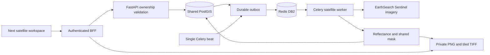

# F02 — Satellite monitoring: implementation and evidence

Workspace synchronization: F02 is also installed in `D:\Fasal Guard Development Workspace\fasalguard-ai`. This older master checkout keeps its existing staged dashboard/F01 changes. Its migration registry was extended only with F02; unrelated C: SMS migration/test changes were not imported. The shared backend helper gained optional platform routing, while existing callers remain core by default. The FastAPI support service was added because this checkout did not yet contain it. Runtime evidence below originated from the earlier isolated C-source snapshot; synchronization checks are recorded separately and do not claim a deployed D: stack.

Date: 2026-10-13. User approved implementation after discovery. Current status: RUN_PASS for the observational vertical slice, tested in isolation and published into the active checkout. No PRODUCTION_VERIFIED claim. The discovery/plan below records the pre-implementation baseline; current changes/results are in the appended implementation record, which supersedes baseline statuses.

## Scope, source of truth and evidence

Farmer story: as a farmer, I can select my field and date range, view actual Sentinel-2 acquisitions clipped to my boundary, inspect NDVI/EVI/NDWI and valid-pixel coverage, and compare comparable acquisitions without treating clouds as crop damage.

The running Docker project points to `C:\Users\Penta Squad\Desktop\AI learning\fasalguard-ai`, branch `restructure/incremental-fastapi`, HEAD `abefcb0ebbe0afbca47c54fac7bedca7ab5c18d0`. Its uncommitted F01/API/Docker work must remain intact. The requested D: workspace checkout is a different source tree: branch `master`, HEAD `1b7c889dd10fa9e45dc20c626640964d18e86b6c`, with staged changes. Do not switch branches or overwrite either checkout. Runtime labels establish deployment provenance, not permission to replace source.

Read root `AGENTS.md` and `CLAUDE.md` in the project checkouts, OpenFarm instructions, and the D: project's `docs/audit/REPOSITORY_AUDIT.md`, `LICENSE_MATRIX.md`, `REAL_VS_MOCK.md`, numerical satellite audit and draft `docs/architecture/FEATURE_MATRIX.md`. The active C: checkout does not contain those audit/matrix documents or an existing F02 document. D: audit evidence is historical and must not be presented as a new run against C:. Read installed Next.js documentation before writing Next.js code as required by AGENTS.md.

Reference: `D:\Fasal Guard Development Workspace\banokabal\OpenFarm`, SHA `884a61567dd0d149214090baf9edebc533a2a0df`, root BSD-3-Clause license. Retain copyright, conditions and disclaimer in adapted source and distribution notices; no contributor endorsement. Review dependency licenses and imagery/provider terms separately; the code license does not license third-party imagery. Reference clone remains unchanged.

## Current implementation and reusable paths

Paths below are relative to the active C: project unless explicitly marked OpenFarm.

| Path | Inspected behavior and reuse |
| --- | --- |
| `services/api/src/domain/satellite/satellite.controller.ts` | Farmer-role scan, layer, statistics, comparison, stress-zone and evidence contracts. Preserve public behavior. |
| `services/api/src/domain/satellite/satellite.service.ts` | Ownership through fields/farms/farmer profiles/users; capture persistence and private media links. Reuse schema and ownership semantics. |
| `services/api/src/domain/satellite/satellite.processor.ts` | BullMQ discovery/render/statistics/stress/finalization; NDVI, NDMI, true color and quality layers. Preserve existing NDMI and evidence behavior. |
| `services/api/src/domain/satellite/providers/copernicus-sentinel-hub.provider.ts` | OAuth, catalog, process/statistical requests, bounded HTTP timeouts and usage tracking. Existing adapter, not a proven live provider run. |
| `services/api/src/domain/satellite/automatic-monitoring.service.ts` | Ten-minute dispatcher, subscription/pilot entitlement checks, due-field SQL locking and thirty-minute recheck. Preserve entitlement semantics. |
| `services/api/src/domain/satellite/automatic-monitoring.processor.ts` | Existing scheduled catalog workflow; coordinate cutover so two schedulers do not own the same fields. |
| `services/api/src/domain/satellite/satellite.entities.ts`, `satellite.enums.ts`, `dto/satellite.dto.ts` | Existing capture/layer/statistics/anomaly contracts and validation. Extend compatibly. |
| `services/api/src/database/migrations/` | Existing satellite migrations with suffixes `satellite-catalog`, `satellite-processing-pipeline`, `automatic-satellite-monitoring`, `satellite-anomaly-evidence`. Use the established TypeORM migration history. |
| `components/intelligence/satellite-workspace.tsx`, `satellite-map-inner.tsx` | Existing farmer workspace, capture selection, map and fetched results. Extend in place. |
| `app/api/fields/[id]/satellite-scans/route.ts`, `satellite-comparison/route.ts`; `app/api/satellite-scans/[id]/` | Existing Next.js BFF routes; preserve browser URLs and session handling. |
| `services/platform-api/app/main.py`, `auth.py`, `db.py`, `config.py`, `worker.py` | Existing FastAPI/Celery deployment and unified JWT/live-session authentication. Extend this service; no duplicate backend or identity system. |
| `services/platform-api/app/crop_scans/storage.py` | Shared private local-media reader with path containment. Add bounded satellite storage operations; do not repurpose JPEG cleaning for rasters. |
| OpenFarm `services/api/app/tasks/indices.py` | `_ndvi`, `_evi`, `_ndwi` formula starting points; validate reflectance input and denominators. EVI clipping must not conceal numerical errors. |
| OpenFarm `services/api/app/tasks/pipeline.py` | `search_scenes`, `read_band_windowed`, `write_cog`, `compute_zonal_stats`, `compute_target_grid`, `process_scene`. Adapt concepts with attribution, not its organization schema or unsafe raster assumptions. |

Existing Nest routes are under URI version `v1`; Next browser routes are under `/api`. Contracts include POST/GET `fields/{fieldId}/satellite-scans`, GET `satellite-scans/{id}`, and GET its `layers`, `statistics`, `stress-zones`, `evidence`; GET `fields/{id}/satellite-comparison`. POST returns 202 and accepts the existing date/cloud DTO. These routes exist by source inspection; authenticated success was not demonstrated in this session.

## Actual status and limitations

| Area | Status | Evidence boundary |
| --- | --- | --- |
| Docker stack | RUN_PASS | Read-only Docker listing shows web, Nest API, FastAPI, workers, PostGIS, Redis, storage and geospatial service running; several report healthy. This verifies container state only. |
| Existing Nest satellite module/UI | IMPLEMENTED_UNTESTED | Actual source inspected; no current UI-to-provider-to-data run. |
| FastAPI/Celery F02 | NOT_STARTED | FastAPI includes crop scans only; worker includes crop-scan tasks only, no F02 beat schedule. |
| Existing satellite tests | IMPLEMENTED_UNTESTED | Provider fixtures/mock fetch, mocked storage, mocked scheduling SQL/queue; not live imagery or Celery proof. |
| Historical C: baseline checks | RUN_FAIL | Host typecheck log lacks `tsc`; Jest log lacks `ts-jest`; container baseline reports one failed suite with 49 passing suites. Not re-executed here. |
| Historical OpenFarm numerical audit | RUN_FAIL | Audit documents wrong raw-DN EVI and absent cloud masking; historical results only. |
| Real F02 acceptance workflow | BLOCKED_EXTERNAL | No current approved field/live acquisition/provider demonstration. Sentinel Hub needs working authorized credentials; availability was not checked. Public STAC alternative still needs a real successful request and data validation. |

No new unit, integration, E2E, lint or build commands were run during this planning phase. No production verification is claimed. No source code, branch, Docker service or volume changed. Documentation is the only planned write.

Missing/risky behavior: EVI and NDWI are absent in the inspected processor/UI; NDMI is a different index. Rendered index layers use dataMask without the same SCL exclusions as statistics. Zero denominators currently become zero. OpenFarm operates on raw digital numbers, does not properly mask SCL/nodata, and uses a degree-based approximate grid. Existing UI fetch errors can collapse into empty results. Tile/storage authorization needs explicit tests; do not import arbitrary-URL TiTiler access or OpenFarm organization identities.

## Acceptance criteria and critical tests

1. An authenticated farmer submits an owned, valid field/date range; receives 202 with a persistent capture/job ID; worker uses the stored boundary and real acquisition timestamp. Reject invalid UUID/range/cloud threshold and oversized/invalid geometry. Unknown or other-owner fields return a non-disclosing error; revoked/expired sessions fail.
2. NDVI=(NIR-red)/(NIR+red); EVI=2.5*(NIR-red)/(NIR+6*red-7.5*blue+1); NDWI=(green-NIR)/(green+NIR). Reflectance sample NIR .45, red .04, blue .03, green .06 gives approximately .83673469, .69965870, -.76470588. Unit tests use tolerances and test zero denominators, NaN and invalid pixels. NDMI remains separately named.
3. Scaling comes from supported collection/asset metadata and baseline conventions. Historical audit: EarthSearch harmonized offset-applied data requires DN/10000; original offset data requires its declared offset. Do not blindly subtract .1 or blindly apply advertised offsets twice. Unknown/contradictory metadata fails explicitly. Test both conventions with recorded provenance and EVI sensitivity to the additive constant.
4. Use a defined metric grid/CRS; test mixed 10m/20m bands. SCL resampling is nearest-neighbor; mask nodata, saturated/defective, shadows, medium/high cloud, cirrus and snow consistently across previews and statistics. Document treatment of unclassified pixels. Prevent invalid pixels entering bilinear interpolation. Clip field exterior, holes and multipolygons; verify adjacent fields never leak pixels.
5. All-masked/no-scene returns explicit unavailable/cloud-blocked results, null statistics and coverage counts, without fake indices or stress alerts. Compare only compatible processing versions/grids and use acquisition timestamps. Explain insufficient historical data.
6. STAC tests cover pagination, no intersecting scenes, cloud filtering, malformed assets, rate limits, timeouts, outage and retry exhaustion. Mock/recorded fixtures are labelled; at least one real scene workflow is required separately.
7. Celery tests cover enqueue failure, transaction/job handoff, duplicate submissions, worker retries/crash, late acknowledgements, idempotent publication and two concurrent scheduler ticks. Only one active scheduler owns a field; preserve paid-plan eligibility.
8. E2E: existing field selector -> submit -> poll -> persisted capture -> masked preview/indices -> two-acquisition trend; test empty/error/retry states and another user's capture/media denial. Real demo records acquisition ID, timestamps, masked counts and DB row IDs with sanitized logs.

## Proposed architecture, contracts and data flow

Extend `services/platform-api/app/satellite/` with router, schemas, repository, provider adapter, raster services and Celery tasks. Retain shared PostgreSQL/PostGIS, existing Redis deployment and private media storage. Adapt OpenFarm STAC/COG processing behind an explicit provider interface; preserve the existing Sentinel Hub route until equivalent replacement is demonstrated. Do not silently change the provider for existing captures. Initial proposed STAC adapter uses supported Sentinel-2 assets with metadata-driven normalization; provider availability and terms remain deployment checks.

Browser -> existing Next BFF/session -> FastAPI authorization/field lookup -> persistent capture plus reliable job handoff -> Celery -> STAC/asset retrieval -> reflectance normalization/SCL mask/field clipping -> private raster + statistics -> database status -> existing UI polling. Record provider, scene/collection, acquired time, geometry snapshot/hash, normalization metadata, mask policy, grid and processing version. Logs include request/capture/job IDs and sanitized provider failures, never JWTs, secrets or asset signatures.

Proposed FastAPI `/api/v1` contracts:

- POST `/fields/{field_id}/satellite-scans`: existing date/cloud input; 202 capture/status. Idempotency key support with actor-scoped semantics.
- GET `/fields/{field_id}/satellite-scans` and `/satellite-scans/{capture_id}`: existing status shape plus provenance/coverage.
- GET `/satellite-scans/{capture_id}/layers` and `/statistics`: existing results plus EVI/NDWI and validity counts.
- GET `/satellite-scans/{capture_id}/layers/{index}/preview`: owner-checked bounded raster preview; no caller-supplied remote URL.
- GET `/fields/{field_id}/satellite-comparison`: compatible acquisition comparison; preserve existing fields or explicitly version changes.

Existing stress-zone/evidence contracts remain on the existing implementation until a reviewed equivalent is ready. Satellite indices are observations, not disease diagnoses. Worker publishing must preserve existing risk/event effects without duplicate notifications.

Use existing User/Farmer/Farm/Field/CropSeason identifiers and satellite capture/layer/statistics tables. Never introduce OpenFarm org IDs. Crop-season linkage, if required, uses the field's existing season relationship and validates ownership. Inspect schema constraints before final migration: add only missing processing provenance, boundary snapshot, coverage/valid counts, and uniqueness for field/provider/acquisition/geometry/processing version. Use existing media_asset references. Do not run an independent Alembic chain over TypeORM-owned tables. Reuse existing durable handoff machinery if sufficient; otherwise add a scoped transactional outbox rather than assuming a DB commit and Redis publish are atomic.

## Minimal implementation sequence after approval

1. Confirm the runtime C: checkout is the approved implementation target; snapshot uncommitted status, define contracts/user stories and reproduce baseline checks without disturbing F01.
2. Add attributed pure raster functions and critical numeric/mask tests. Add minimal migration/repository/authenticated APIs to the existing FastAPI service.
3. Add one-field/one-acquisition STAC task, bounded retries/timeouts, durable handoff, private outputs and deterministic empty/error states. First prove a real persisted capture and owner-checked preview.
4. Route the existing BFF/workspace to that slice with rollback capability; add EVI/NDWI and visible errors while preserving NDMI and existing layout. No React Native changes are needed for this web-first feature.
5. Add compatible multi-acquisition trends and one Celery beat schedule with entitlement and concurrency tests. Disable overlapping legacy scheduling only after reviewed cutover; keep unrelated BullMQ/F01 work operating.
6. Run checks and real E2E evidence, document every failure/blocker, obtain independent review, then assess production readiness. Completing the first slice does not complete all F02 acceptance criteria.

Likely changed paths: new `services/platform-api/app/satellite/*` and `tests/satellite/*`; existing platform `main.py`, `worker.py`, `config.py`, requirements; one TypeORM migration as needed; existing satellite BFF routes/UI; scoped `compose.platform.yml` service/scheduler configuration; attribution notices and this document. Exact file/function changes will be recorded after implementation; none are implemented now.

## Dependencies, operations and planned commands

Existing services: Next.js, Nest modules retained during migration, FastAPI/Celery, PostgreSQL/PostGIS, Redis and shared private media. Evaluate pinned compatible `rasterio`/GDAL, `shapely`, `pyproj`, STAC client and COG tooling; NumPy/httpx already exist. Prefer bounded authenticated previews over introducing an unrestricted TiTiler service. Account for raster memory, task limits, dataset size limits and remote range-request support. No new database, frontend framework or separate satellite backend.

Existing environment names: `DATABASE_URL`, `REDIS_URL`, `PLATFORM_CELERY_BROKER_URL`, `JWT_ACCESS_SECRET`, `JWT_ISSUER`, `JWT_AUDIENCE`, `MEDIA_LOCAL_DIR`, `LOG_LEVEL`, `CORE_API_INTERNAL_URL`, `INTERNAL_SERVICE_TOKEN`; existing Sentinel adapter `SENTINEL_HUB_CLIENT_ID`, `SENTINEL_HUB_CLIENT_SECRET`, `SENTINEL_HUB_BASE_URL`, `SENTINEL_HUB_AUTH_URL`. Proposed configuration names: `SATELLITE_STAC_URL`, `SATELLITE_STAC_COLLECTION`, `SATELLITE_ASSET_HOST_ALLOWLIST`, `SATELLITE_HTTP_TIMEOUT_SECONDS`, `SATELLITE_MAX_PIXELS`, `SATELLITE_PROCESSING_VERSION`, `SATELLITE_SCHEDULER_ENABLED`. Document selected provider and storage settings after implementation. No environment values were read or included in this plan.

Prospective commands, not executed acceptance results:

```powershell
# From approved active project, with dependencies installed
npm run lint
npx tsc --noEmit
npm run build
# From services/api
npm run typecheck
npm test -- --runInBand --runTestsByPath test/sentinel-hub-provider.spec.ts test/satellite-storage.spec.ts test/automatic-monitoring.spec.ts
# From services/platform-api, after satellite tests exist
python -m ruff check app tests
python -m pytest tests/satellite -m "not integration"
python -m pytest tests/satellite -m integration
# From project, after E2E scenario exists
npx playwright test tests/e2e/satellite.spec.ts
```

Verify actual API package scripts before executing; unavailable tooling is a blocker, not a pass. Integration fixtures must use an isolated test database/storage/queue, never existing production volumes. Migration up/down/up is tested there only. Record commands, exit codes, sanitized output and real provider acquisition evidence. Do not reset volumes or run destructive Docker commands.

Security/privacy: enforce live-session authorization on every capture/statistics/raster route; worker revalidates persisted field scope; raster keys are server-generated and owner-checked. Bound geometry, pixels, URLs, redirects and request duration; allowlist remote hosts and prohibit private-network asset fetches. Treat field boundaries and acquisition histories as private. Use deterministic object publication, cleanup and retention rules; suppress signed URLs and precise private geometry from logs. Offline/outage UI retains explicitly stale historical results and never invents fresh observations.

The preceding discovery plan is historical. User subsequently approved the implementation below.

## Implementation record — 2026-10-13

The approved observational scope is implemented in the existing FastAPI service and Next workspace. Unified User/FarmerProfile/Farm/Field records and the shared PostGIS database are reused; existing CropSeason identities are preserved without inventing an observation-season association. React Native is unnecessary for this web workflow. Existing F01 routes/default Celery queue, NDMI and historical Nest satellite routes remain.

### Files and responsibilities

- `services/platform-api/app/satellite/{science,provider,raster,repository,router,tasks}.py`, package init: reflectance/shared masks, fixed STAC adapter, bounded metric raster windows, SQL persistence, owner-authorized APIs and durable task pipeline.
- `services/platform-api/app/{config,main,worker}.py`, `requirements.txt`, `Dockerfile`, `OPENFARM-LICENSE.txt`: configuration/wiring/dependencies/media permissions/full notice.
- `services/api/src/domain/satellite/{spectral-indices.ts,satellite.processor.ts,automatic-monitoring.service.ts}`: EVI/NDWI and consistent scripts, projected statistical grid and scheduler cutover.
- `services/api/src/infrastructure/database/migrations/1755000037000-satellite-platform-outbox.ts` and registry: outbox and provenance-aware scene uniqueness. No duplicate identity tables.
- `lib/auth/satellite-backend.ts`, five existing capture/comparison BFF routes, new private layer-content route: opt-in FastAPI routing, legacy layer fallback, authenticated streaming.
- `components/intelligence/satellite-workspace.tsx`: date/cloud controls, EVI/NDWI means, index selection/previews, errors/retry and comparable trends in existing UI.
- `Dockerfile.web`, `services/api/Dockerfile`, `compose.platform.yml`, `licenses/OPENFARM.txt`: distribution notices and runtime wiring.
- `services/platform-api/tests/satellite/*`, `services/api/test/spectral-indices.spec.ts`, `tests/e2e/satellite-live.cjs`: scientific, raster, provider, authorization, persistence, concurrency and browser tests. `notification-processor.spec.ts` corrects an existing stale test constructor/fixture only; notification application behaviour is unchanged.

### Scientific and BSD corrections researched on primary sources

The implemented four formulas use physical reflectance. EVI's additive constant means raw digital numbers are scientifically incorrect even when normalized ratios happen to cancel scaling. NDWI is green/NIR surface-water contrast, separately named from NIR/SWIR NDMI. Near-zero/nonfinite denominators are invalid pixels, never healthy zeroes. Scientific EVI is not clipped; preview colour limits are presentation-only. Consulted [EVI formula](https://custom-scripts.sentinel-hub.com/custom-scripts/sentinel-2/evi/) and [NDWI definition](https://github.com/sentinel-hub/custom-scripts/blob/main/sentinel-2/ndwi/README.md); external custom-script code was not copied.

Scale must be finite and positive in asset metadata. Harmonized EarthSearch legacy assets with `earthsearch:boa_offset_applied=true` already contain their BOA offset: do not subtract the advertised −.1 a second time. Ambiguous legacy nonzero offsets fail `AMBIGUOUS_RADIOMETRY`. Raw C1 normalization is unit-tested, but the HTTP adapter currently supports only `sentinel-2-l2a` and its fixed Sentinel S3 host. Provenance saves collection, scale/offset and harmonization flag. Sources: [Sentinel Hub units/harmonization](https://docs.sentinel-hub.com/api/latest/data/sentinel-2-l2a/), [EarthSearch issue66](https://github.com/Element84/earth-search/issues/66).

One mask accepts SCL4/5/6 only and requires every band/denominator valid, consistently across all indices, previews and statistics. Reject nodata, defective/saturated pixels, shadows, uncertain classes, clouds/cirrus and snow. Total masked-pixel percentage is distinct from cloud/shadow percentage; scene cloud coverage is a tile prefilter. Source: [Copernicus SCL processing](https://sentiwiki.copernicus.eu/web/s2-processing). Grid is snapped10m in projected metre CRS; original20m SCL/SWIR are nearest-resampled, not new10m source information. Pixel-centre clipping excludes field exterior/holes/adjacent fields. Tiled georeferenced GeoTIFF output is not claimed validated COG output. No index is a disease diagnosis, calibrated crop-health score or yield prediction.

BSD-3-Clause requires retaining the original copyright, conditions and disclaimer in source redistribution and reproducing them in binary-distribution materials; contributor names must not imply endorsement. Attribution alone is insufficient. The complete original OpenFarm notice is retained in project/service files and copied into all relevant Docker distributions. Source: [OSI BSD-3-Clause](https://opensource.org/license/BSD-3-clause). Provider/imagery terms are separate: [Copernicus legal notice](https://sentinels.copernicus.eu/documents/247904/690755/Sentinel_Data_Legal_Notice) requires acknowledgement of modified Copernicus Sentinel data for the acquisition year; [EarthSearch](https://github.com/Element84/earth-search) is an external public service without a project-controlled availability guarantee.

### Pipeline and contracts

Browser → authenticated Next BFF → FastAPI JWT/live-session/role/field ownership → atomic capture+outbox → single beat dispatcher → RedisDB2 satellite queue → Celery field advisory lock → STAC acquisition → bounded remote raster windows → reflectance/SCL/field mask → private PNG/tiled TIFF → atomic media/statistics/capture completion → UI polling/private image. Late acknowledgements/redelivery and dispatch lease expiry are safe; field locking spans scene selection and publication across capture IDs. Completed-scene uniqueness includes boundary hash and processing version so corrected processing/changed boundaries can reprocess. Comparison requires same boundary hash/version/grid and uses acquisition timestamps.



FastAPI prefix `/api/v1`; browser prefix `/api`. POST `/fields/{fieldId}/satellite-scans` returns202 capture with aware past ISO `from`/`to`, ordered≤90days, optional finite `maxCloudCoverage`0–100. GET same path lists owned captures. GET `/satellite-scans/{id}`, `/statistics`, `/layers` and `/layers/{type}/content` enforce ownership; unknown/nonowner404. Four statistics and nine private outputs are stored; no valid pixels means null means, not fake values. GET `/fields/{id}/satellite-comparison` returns comparable observations or insufficient history. Legacy layer marker409 makes BFF retry the existing owner-checked core endpoint. Existing `/evidence` and `/stress-zones` remain core-owned.

### Environment, dependencies and operations

Existing names: `DATABASE_URL`, `REDIS_URL`, `JWT_ACCESS_SECRET`, `JWT_ISSUER`, `JWT_AUDIENCE`, `MEDIA_LOCAL_DIR`, `PLATFORM_CELERY_BROKER_URL`, `PLATFORM_API_URL`, `FASALGUARD_API_URL`. Credential values are never documented. `SATELLITE_PLATFORM_ENABLED` defaultsfalse; set consistently on web/core/platform for cutover, disabling the legacy automatic dispatcher. Manual outbox dispatch works independently of scheduled-monitoring enablement. `SATELLITE_MAX_PIXELS` default1000000, bounded100–4000000.

Dependencies: rasterio/GDAL/libexpat1, shapely, NumPy/Pillow, PostGIS, Redis, HTTPS access to fixed EarthSearch/Sentinel S3 hosts, persistent private media and exactly one beat. Worker consumes `celery,satellite` so F01 remains serviced. Platform API media mount is read-only; worker read/write. Platform UID1000 matches inspected existing media owner; no production volume permissions were changed.

Provider HTTP timeout25s and capped pages/windows, rate-limiter Redis timeout2s, BFF timeout12s, satellite task soft/hard540/600s with bounded retries. Ownership is rechecked before publication. Private contained server-generated paths, owner-checked media reads, no-store/nosniff, UUID/date/cloud/geometry validation, per-user limits and sanitized capture/request logs are implemented. API clients cannot choose arbitrary imagery URLs. Field boundaries are sent to the external catalog, which must be disclosed in privacy policy. Private failed-attempt file retention/cleanup remains an operational policy item.

### Actual validation results

All runtime tests use isolated `fasalguard-f02-*` containers/network and disposable `f02_test` PostGIS, never existing volumes. Test identities/credentials/media are synthetic fixtures and must not be published. Existing application stack remains untouched.

| Check | Actual result |
|---|---|
| `pytest -q --tb=short` (integration deselected) | RUN_PASS:87 platform unit tests passed, including F01 and numeric/offset/denominator/SCL/nodata/geometry/mixed-grid/provider/auth/broker cases. |
| `ruff check app tests` | RUN_PASS:all final checks passed. |
| `pytest -m integration -q tests/satellite/test_integration.py` | RUN_PASS:7 passed. Atomic outbox/no-scene/idempotency, revoked session, broker outage, provider retry exhaustion, field lock, publication/reprocessing/other-user media denial, paid/free concurrent scheduler ticks. Initial driver/fixture omissions were corrected without weakening production checks. |
| API typecheck/build/targeted Jest | RUN_PASS:23 tests in5suites; final typecheck and new-file ESLint also exit0. Existing provider/storage/scheduler/notification tests included. |
| Migration up/down/up | RUN_PASS:all37 migrations applied; F02 reverted/reapplied, each exit0 on dedicated PostGIS. |
| Final web `tsc --noEmit`, scoped ESLint, `next build` | RUN_PASS:all exit0 including date/cloud controls. |
| Real STAC/raster smoke | RUN_PASS:14 eligible2025 scenes; `S2B_42RYV_20250109_0_L2A`, acquired2025-01-09T06:00:27.940Z,422/422valid field pixels. NDVI .51297158, EVI .34868824, NDWI−.49545607, NDMI .20416629. EPSG32642,10m grid21×24; nine outputs. |
| Current catalog compatibility | RUN_PASS:actual supported L2A acquisition2026-10-11 available; C1's different asset host remains outside adapter scope. |
| Real Celery data publication | RUN_PASS:isolated beat/Redis/worker processed real public imagery and committed captures/statistics/media. Final browser evidence recorded separately below. |
| Independent Codex review | Completed twice: no remaining high-severity science/access/dedup source blocker. Reviewer did not independently rerun tests and required explicit limitations and browser evidence. |

Commands: platform test image `docker build --target test services/platform-api`; run `ruff check app tests`, `pytest -q tests/satellite`, integration command above with separately migrated database named `f02_test` (test guard). API `npm run typecheck`, `npm run build`, `npm test -- --runTestsByPath test/spectral-indices.spec.ts test/sentinel-hub-provider.spec.ts test/satellite-storage.spec.ts test/automatic-monitoring.spec.ts test/notification-processor.spec.ts`, `npm run migration:run`, `npm run migration:revert`, `npm run migration:run`. Web `npx tsc --noEmit`, scoped `npx eslint`, `npm run build`. Browser test fixture `python -m tests.satellite.browser_fixture`; isolated web `NODE_PATH=/app/node_modules node /source/tests/e2e/satellite-live.cjs`. Sanitized results are in `docs/features/f02-results/`.

### Limits and next action

BLOCKED_EXTERNAL: live Sentinel Hub compatibility needs authorized credentials; mocked provider tests do not prove live service. No production rebuild/cutover or verification occurred. New FastAPI captures do not run legacy anomaly/risk/event/notification processing; original routes remain. Scientific monitoring is the accepted vertical slice, not a disease model. Conservative masks can reduce coverage; tiny fields may have no pixel centres. HTTP adapter rejects ambiguous legacy radiometry and does not yet support C1. GeoTIFFs are not claimed validated COGs. Test-origin configuration must match the existing Next mutation-origin guard (isolated server bind origin0.0.0.0); normal deployment origin/proxy configuration still requires verification.

## Final working evidence and next action

Status: RUN_PASS for the scoped observational implementation. Forty-four scoped files were published into the active C: checkout with original-file backups and SHA256 verification; remaining final test/docs/whitespace edits were synchronized separately. No branch switch, production container restart, migration or volume reset occurred.

Final Python run `pytest -q --tb=short`:87 passed,7 integration tests deselected,64 dependency deprecation warnings,15.74s,exit0. Final integration run:7 passed,1 dependency warning,72.93s,exit0. Final source/raster correction uses `f02-reflectance-scl-v2`: the field centroid determines a stable snapped10m UTM grid, independent of overlapping Sentinel tile zones. An actual GeoTIFF regression test reprojects an alternate source tile and verifies identical output grid/provenance. An empty-evidence UI guard now avoids claiming no anomalies when no analysis exists.

Real browser test `tests/e2e/satellite-live.cjs`:exit0, followed by `satellite-trend-ui.cjs`:exit0. Actual capture `99477595-b04d-4a34-85a8-80b8519361b1`, acquired2025-01-09T06:00:27.940Z, providerEARTHSEARCH_STAC:428/428valid pixels; EVI .34824494, NDVI .51399398, NDWI−.49532190, NDMI .20380145. Second capture `401e29a9-1f24-4e6b-b897-f5a39e037e08`, acquired2026-10-01T06:00:28.594Z: EVI .56927526. Both useEPSG32643,21×23 snapped10m output, same boundary/processing version; comparison reportsPREVIOUS_VALID_OBSERVATION. These are observations from different acquisition periods, not calibrated seasonal/stress conclusions. Contains modified Copernicus Sentinel data (2025 and2026), processed by Fasal Guard.

The test proved UI submission202 → committed outbox → beat/Redis/Celery → actual remote imagery → persisted four indices/nine private layers → real EVI PNG rendering. It also proved FastAPI409/core200 legacy layer fallback and another user's capture/image404. A separate browser assertion rendered both real EVI observations in Change detection. Evidence: `f02-results/browser-live.json`, `browser-evi.png`, `browser-trend.png`; final web/API logs and `checks.json` record commands/results. Earlier browser failures exposed mismatched test origin/reloaded processing versions and ambiguous historical radiometry; they were not reported as passes. Unsupported radiometry remains an explicit scientific failure rather than guessed reflectance.

Final independent source review covered the canonical grid/version/evidence guard and found no new concrete blocker. Reviewer did not independently rerun parent tests. BLOCKED_EXTERNAL remains live Sentinel Hub credential validation; tiled GeoTIFF/legacy anomaly-processing limitations above remain. Existing mutation-origin guard requires matching deployment host/origin/proxy configuration and still needs deployment verification.

Next recommended action: review and apply the concrete migration/configuration cutover on the deployment stack, validate shared media permissions and configured public origin, then perform production smoke testing. `SATELLITE_PLATFORM_ENABLED` remainsfalse by default; production verification is not claimed.

## QA remediation record — 2026-10-16 (defect D10 of `docs/qa/QA_F01-F05.md`)

Status unchanged: RUN_PASS for the observational slice, not PRODUCTION_VERIFIED.

D10 (second scan on the same field stayed `QUEUED` for about 15 minutes): cause confirmed in `services/platform-api/app/satellite/tasks.py`. `satellite.dispatch` leases each outbox row for 15 minutes when it publishes (crash recovery). When a sibling capture of the same field held the per-field advisory lock, `satellite.process` returned `ALREADY_RUNNING` without changing the lease, so the loser waited the full 15 minutes. Fix: the lock loser now shortens its own outbox `next_dispatch_at` to 45 s (`repo.defer_outbox`), so the 30 s beat redispatches it soon after the sibling finishes. The UPDATE blocks on the row lock that dispatch holds until it commits, so it always lands after the lease write; the crash-recovery lease for a worker that dies mid-task is unchanged. Scans for one field remain serialized by design (scene selection and publication), so the second still waits for the first; the wait is now bounded by about one beat plus the first scan's duration instead of 15 minutes. The redispatch reuses `task_id=satellite-<capture>` and is idempotent.

Evidence: new unit test `test_lock_loser_shortens_outbox_lease` and an added assertion in the existing PostGIS test `test_field_lock_excludes_concurrent_scene_selection` (outbox wait <= 60 s after losing the lock). Platform pytest in a `python:3.12` container: 219 passed, 6 skipped (the PostGIS integration tests are deselected by default and were NOT run, so the new integration assertion is unexecuted). The live two-scan scenario F02-18 was not re-run. D11 (boolean accepted as cloud cover, no `failureCode` exposed) is not addressed.

## Sample preview fallback — 2026-10-16

When no real capture can be shown (latest scan FAILED, CLOUD_BLOCKED, NO_VALID_SCENE, or no scan exists) `/satellite` now shows a clearly labelled SAMPLE PREVIEW instead of an empty panel: synthetic statistics, three illustrative zones placed inside the field's own boundary, and a placeholder trend. It carries a persistent "SAMPLE DATA - illustrative only" banner, SAMPLE badges/watermark, "(sample)" metric labels, and AI interpretation and next-step actions are disabled. Any COMPLETED real capture (even an old one, flagged when older than 14 days) always takes priority, and in-progress real scans keep the real progress UI. Sample values are browser-memory only: not stored, exported, alerted on or returned by any API. These numbers are not satellite measurements. Code: `features/satellite/`; tests: `tests/satellite`; evidence and limits: `docs/qa/SATELLITE_SAMPLE_FALLBACK.md`.
